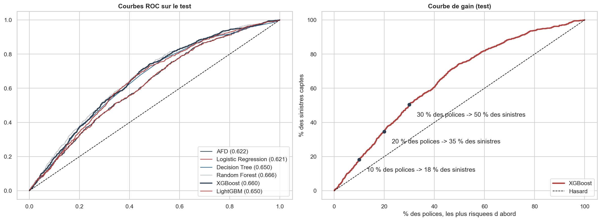

# Tarification automobile et prédiction des sinistres

Deux travaux d'actuariat non-vie sur des portefeuilles d'assurance automobile, réalisés à l'ESSAI.

## 1. Tarification et sinistres graves (`01_tarification_sinistres_graves.ipynb`)

- Contrôles de qualité sur environ **21 600 contrats** et leurs sinistres (cohérence entre bases, polices inexistantes, valeurs aberrantes).
- Séparation des sinistres **attritionnels** et **graves** : choix du seuil par la méthode **Peaks Over Threshold** (loi de Pareto généralisée, test de Kolmogorov-Smirnov, bootstrap).
- Prime pure = fréquence × coût moyen : **763 € par année-police** au global, puis déclinée par segment.

Projet réalisé en groupe dans le cadre du cours d'actuariat non-vie.

## 2. Prédiction des sinistres (`02_prediction_sinistres.ipynb`)

Prédiction de la survenance d'un sinistre sur **58 592 polices**, dont 6,4 % ont eu un sinistre.

- **Sans fuite d'information.** Le découpage train/test est fait en premier. L'encodage, le rééquilibrage, la sélection, le réglage et le seuil sont appris sur le train, à l'intérieur de pipelines.
- **Rééquilibrage.** SMOTE, ADASYN, sous-échantillonnage et pondération sont chacun réglés, puis comparés par validation croisée.
- **Sélection de variables adaptée à chaque modèle :**
  - stepwise pour l'AFD et la régression logistique ;
  - RFECV pour l'arbre et la forêt ;
  - importance par permutation pour XGBoost et LightGBM.
- **Six modèles réglés** par recherche aléatoire d'hyperparamètres, XGBoost sur carte graphique.

| Modèle | AUC (validation croisée) | AUC test |
|---|---|---|
| Régression logistique | 0,607 | 0,621 |
| Arbre de décision | 0,632 | 0,650 |
| Forêt aléatoire | 0,653 | 0,667 |
| **XGBoost** | **0,654** | 0,660 |

En ciblant les 30 % de polices jugées les plus risquées, on capte **50 % des sinistres**. La performance reste modeste : la survenance dépend surtout de facteurs absents des données (conduite, kilométrage). L'ancienneté du contrat (effet d'exposition) et l'âge du véhicule sont les variables les plus utiles.

## Données

Les données ne sont pas publiées dans ce dépôt. Pour relancer le notebook 02, placer `Insurance_claims.csv` dans `data/`.

Technologies : Python, pandas, scikit-learn, imbalanced-learn, XGBoost, LightGBM, SHAP, SciPy.
